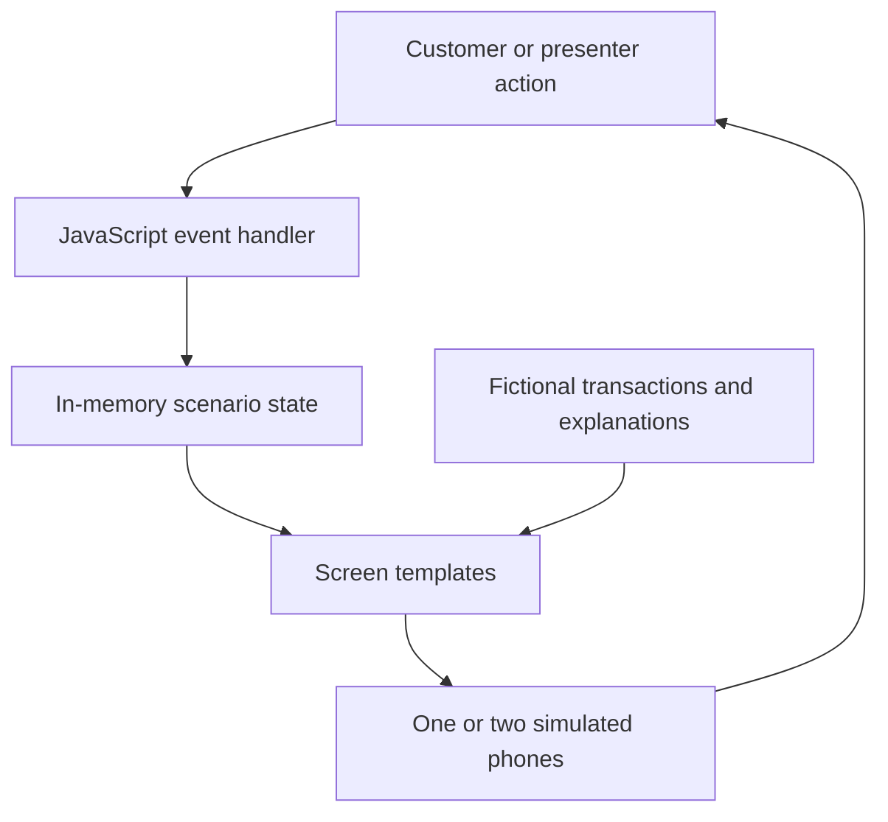
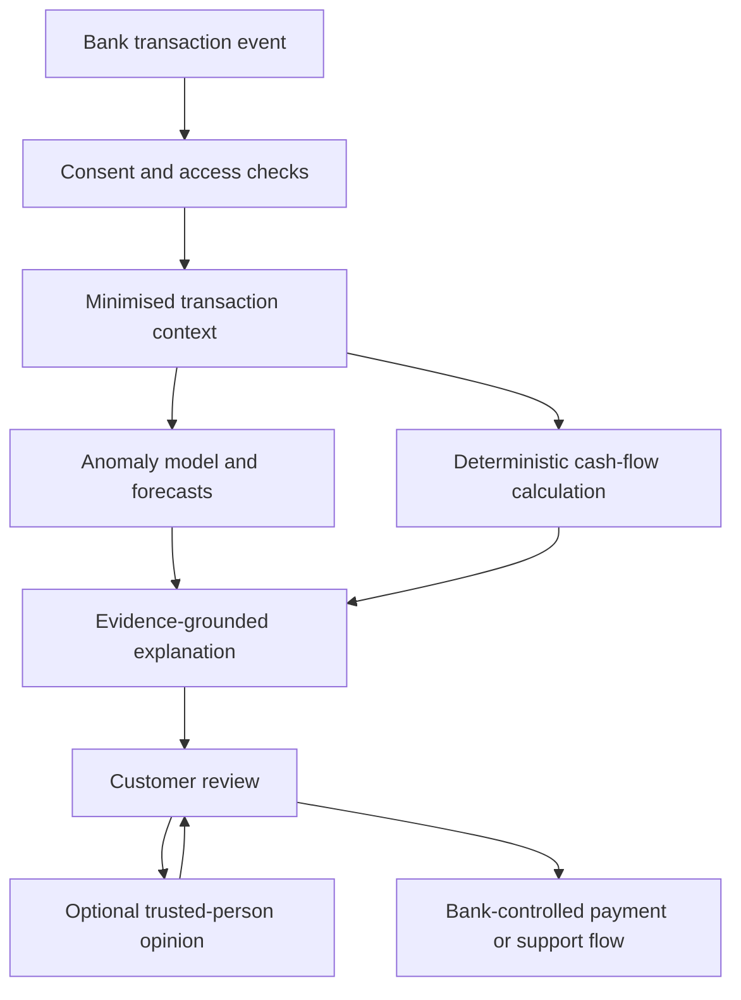

# Technical architecture and boundaries

## Implemented prototype

`index.html` contains the presentation, fictional data and a JavaScript state machine. Scenario definitions set initial states and presenter navigation. View functions render screens. Event delegation handles button actions. State is held in browser memory and resets on reload. Scripted copy represents AI explanations; fixed values represent forecasts and anomaly signals.

No network requests, model inference, bank integrations, phone address-book reading, real location lookup, outbound messages or actual card/payment actions are implemented. Trusted-person invitations and responses operate locally between simulated phones.

## Proposed production design

The following is a future integration concept, not functionality delivered by this repository. Availability of Westpac internal interfaces has not been confirmed.

AI would identify context-dependent deviations, estimate recurring income/bill patterns, and explain evidence in plain language. Rules enforce preferences, thresholds, consent and routing. Arithmetic calculates bill and savings effects. Bank controls retain payment authority. A trusted person has no payment authority.

Potential model inputs: appropriately scoped transaction amounts/categories/timestamps, payee familiarity, balances, recurring obligations, customer-set goals and preferences, and optional coarse location with recency/accuracy. No phone contacts or unrestricted account access is required. Trusted people would pair through verified invitations, QR codes or codes; this needs a secure production identity and consent design.

The demo’s holds, card blocks, replacement-card messages and Smart SafeBlock behaviour are scripted illustrations, not verified descriptions of production banking behaviour. Any real integration must follow the bank’s actual capabilities and policies.
